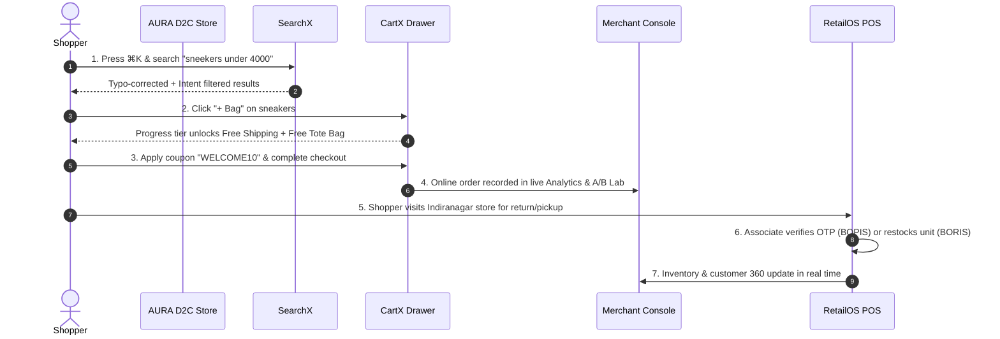

# DevX Commerce Suite — Manual Testing & QA Guide

**Authoritative QA Runbook for Product Managers, QA Engineers, and Evaluators**  
**Project**: DevX Commerce Platform (CartX | SearchX | RetailOS)  
**Target Environments**: Live Production Cloud (Render Backend + Vercel Frontends)  
**Last Updated**: October 2026

---

## 1. Live Environment Quick Directory

Share these direct links with your testers:

| Application | Live Production URL | Description |
|---|---|---|
| **🛒 AURA D2C Storefront** | [https://devx-3.vercel.app/](https://devx-3.vercel.app/) | Shopper experience, collection carts, CartX embed drawer, and SearchX `⌘K` modal. |
| **⚙️ Merchant Admin Console** | [https://devx-console.vercel.app/](https://devx-console.vercel.app/) | CartX configuration, A/B Testing Lab, SearchX Studio, and Case Studies Gallery. |
| **📱 RetailOS POS Terminal** | [https://devx-retailos.vercel.app/](https://devx-retailos.vercel.app/) | Touchscreen register, BOPIS station, BORIS returns, Multi-Location matrix, and AI Clienteling. |
| **⚡ Backend REST API** | [https://devx-commerce-api.onrender.com/](https://devx-commerce-api.onrender.com/) | Live Fastify server, SQLite database, and static widget host (`/cartx.js`). |

> [!TIP]
> All three frontend applications feature top-navigation cross-links in the header/footer to let testers navigate between Storefront, Merchant Console, and RetailOS with a single click.

---

## 2. Pre-Seeded Test Data Reference

Use these pre-seeded identifiers during your test runs:

- **Store**: `store_aura` (AURA Lifestyle)
- **Active Coupon Codes**:
  - `WELCOME10`: 10% discount on orders above ₹999 (Max savings ₹500).
  - `FESTIVE20`: 20% discount on orders above ₹1,999 (Max savings ₹800).
- **Physical Store Locations**:
  - `loc_store_01`: Indiranagar Flagship Store (Bengaluru)
  - `loc_store_02`: Koramangala Concept Store (Bengaluru)
  - `loc_wh_01`: Central Dark Warehouse (Whitefield)
- **Sample BOPIS Order for Pickup Testing**:
  - Order ID: `ord_bopis_781`
  - Customer: `Rahul Sharma`
  - Handover Verification PIN / OTP: **`7482`**
- **Sample Online Order for BORIS Return Testing**:
  - Order ID: `ord_ctrl_1`
  - Customer: `Aditya Verma`
- **Customer 360 Profiles (Clienteling)**:
  - Customer ID: `cust_101` (Arjun Kapoor)
  - Customer ID: `cust_102` (Sneha Reddy)

---

## 3. Test Suite 1: CartX (AI-Powered Conversion Cart)
**Test Environment**: Storefront ([https://devx-3.vercel.app/](https://devx-3.vercel.app/))

### TC-CX-01: Progress Milestones & Free Shipping Unlock
- **Goal**: Verify dynamic milestone calculations and free shipping unlock.
- **Steps**:
  1. Open the Storefront.
  2. Click **Bag** (or any product's **+ Add to Bag** button).
  3. Observe the progress bar at the top of the cart drawer.
  4. Add an item below ₹999 (e.g. *Organic Cotton Rib Beanie* at ₹799).
  5. Check progress bar prompt (should state: *"Add ₹200 more for Free Shipping"*).
  6. Add another item so the cart exceeds ₹999.
- **Expected Result**: Progress bar dynamically animates, displays unlocked checkmark, and shipping cost displays as **FREE** (`₹0`).

---

### TC-CX-02: Auto-Freebie Injection & Removal
- **Goal**: Verify automatic tier gift addition and removal.
- **Steps**:
  1. In the CartX drawer, add items to reach **₹1,999** or more (e.g. *Acid Wash Heavy Fleece Hoodie* at ₹2,499).
  2. Inspect cart items list.
  3. Notice a **Free Canvas Tote Bag** is automatically injected into the cart with a green `FREE GIFT` badge and `₹0` price.
  4. Now delete items or reduce quantities so the subtotal falls below ₹1,999.
- **Expected Result**:
  - When passing ₹1,999, the tote bag is immediately added with zero cost.
  - When dropping below ₹1,999, the tote bag is automatically removed with zero orphan gift leaks.

---

### TC-CX-03: Tier 3 Percentage Discount (₹2,999+ Tier)
- **Goal**: Verify automatic order-level bundle discount at Tier 3.
- **Steps**:
  1. Add items to exceed ₹2,999 (e.g. *Heavy Fleece Hoodie* ₹2,499 + *Oversized Graphic Tee* ₹1,299 = ₹3,798).
  2. Look at the subtotal calculations.
- **Expected Result**: A dynamic 15% tier discount is automatically applied to the order total with a highlighted celebration banner.

---

### TC-CX-04: Coupon Code Engine & Edge Cases
- **Goal**: Test valid coupons, minimum spend requirements, and max discount caps.
- **Steps**:
  1. With a cart subtotal above ₹999, locate the **Have a promo code?** input in the CartX drawer.
  2. Enter `WELCOME10` and click **Apply**.
  3. Verify a 10% discount is deducted from the order total.
  4. Test edge cases:
     - Enter an invalid coupon code (e.g. `BOGUS99`) $\rightarrow$ verify error message: *"Invalid or expired coupon code"*.
     - Reduce cart value below ₹999 with `WELCOME10` applied $\rightarrow$ verify code is rejected due to minimum spend requirement.

---

### TC-CX-05: 15-Minute Reservation Countdown Timer
- **Goal**: Verify cart hold urgency timer functionality.
- **Steps**:
  1. Inspect the top banner of the CartX drawer.
  2. Observe the countdown timer starting at `14:59` and ticking down every second.
- **Expected Result**: Urgency countdown persists as long as the shopper is interacting with the cart.

---

### TC-CX-06: Deterministic A/B Variant Assignment
- **Goal**: Verify sticky variant allocation without tracking cookies.
- **Steps**:
  1. Look at the top-right pill in the storefront navbar: shows either **Variant A (Control)** or **Variant B (CartX AI)**.
  2. Refresh the browser page 5 times.
  3. Verify the assigned variant remains completely sticky for this visitor.
  4. Click the **Test New Visitor (A/B)** button in the header.
- **Expected Result**: Generates a new visitor hash; across multiple tests, visitors distribute roughly 50/50 between Variant A and Variant B via deterministic FNV-1a hashing.

---

### TC-CX-07: In-Cart AI Upsells
- **Goal**: Verify personalized cart recommendations.
- **Steps**:
  1. Open the CartX drawer.
  2. Scroll to the **Frequently Bought Together** section at the bottom.
  3. Verify that items currently already in the cart are **not** suggested as upsells.
  4. Click the **+ Add** button on any recommended item.
- **Expected Result**: The upsell item is instantly added into the cart, and the progress bar updates in real time.

---

### TC-CX-08: Complete Checkout & Conversion Record
- **Goal**: Complete an online checkout and record live analytics.
- **Steps**:
  1. With items in the cart, click the green **Complete Secure Checkout** button.
  2. Verify an order confirmation modal appears with a generated Order ID (e.g. `ord_...`).
  3. Note down the Order ID.
  4. Open the [Merchant Admin Console](https://devx-console.vercel.app/) $\rightarrow$ **Live Analytics**.
- **Expected Result**: The Total Revenue, Orders count, and Conversion Funnel in the Admin Console update with the new transaction.

---

## 4. Test Suite 2: SearchX (Hybrid Semantic Discovery Engine)
**Test Environment**: Storefront ([https://devx-3.vercel.app/](https://devx-3.vercel.app/)) & Merchant Console ([https://devx-console.vercel.app/](https://devx-console.vercel.app/))

### TC-SX-01: Keyboard Shortcut `⌘K` / `Ctrl+K` Overlay
- **Steps**:
  1. On the storefront, press `⌘K` (on macOS) or `Ctrl+K` (on Windows/Linux), or click the **Search drops...** search bar in the navbar.
- **Expected Result**: An animated, high-contrast SearchX modal instantly opens with focus ready in the input field. Pressing `ESC` closes the modal.

---

### TC-SX-02: Levenshtein Typo Tolerance
- **Steps**:
  1. Open the search overlay.
  2. Type a misspelled query: `sneekers`.
- **Expected Result**: SearchX automatically corrects the typo to `sneakers` and returns the *Horizon Chunky Sneakers* with matching badges.

---

### TC-SX-03: Natural Language Budget & Category Intent
- **Steps**:
  1. In the search box, type: `pants under 2000`.
- **Expected Result**:
  - SearchX extracts the intent chip: **Max Price: ₹2,000** and category **Pants**.
  - Only qualifying bottom garments with price $\le$ ₹2,000 are returned (e.g., *Vintage Relaxed Cargo Pants*). Items exceeding ₹2,000 are excluded.

---

### TC-SX-04: Domain Synonyms Expansion
- **Steps**:
  1. In the search box, type: `kicks`.
- **Expected Result**:
  - The synonym expansion engine maps `kicks` $\rightarrow$ `sneakers, shoes, runners`.
  - Footwear products appear in results even though the word "kicks" is not in their product title.

---

### TC-SX-05: Merchandising Rules & Product Pinning
- **Steps**:
  1. Search for `hoodie`.
- **Expected Result**: The *Acid Wash Heavy Fleece Hoodie* appears pinned at position #1 with a highlighted **Merchant Pick** badge.

---

### TC-SX-06: 1-Click `+ Bag` Addition from Search
- **Steps**:
  1. Search for any item in the SearchX overlay.
  2. Click the **+ Bag** button directly on the result card.
- **Expected Result**: The item is immediately added to CartX, the search modal closes, and the CartX drawer opens showing the updated cart.

---

### TC-SX-07: SearchX Studio & Live Query Simulator (Console)
- **Steps**:
  1. Open [https://devx-console.vercel.app/](https://devx-console.vercel.app/).
  2. Click the **SearchX Discovery Studio** tab in the sidebar.
  3. Inspect the **Query Analytics** cards: Search Volume, Click-Through Rate (CTR %), and Zero-Result Queries.
  4. Scroll to **Live Query Simulator**:
     - Type queries into the simulator input (e.g. `cargo under 2500`).
     - Inspect the live Intent Extraction, Merchandising Boosts, and Result preview JSON.

---

## 5. Test Suite 3: RetailOS (Touchscreen POS & In-Store Operations)
**Test Environment**: RetailOS Terminal ([https://devx-retailos.vercel.app/](https://devx-retailos.vercel.app/))

### TC-RT-01: Touchscreen POS Register & Floor Stock Check
- **Steps**:
  1. Open RetailOS POS.
  2. In the top bar, verify the location selector defaults to **Indiranagar Flagship Store**.
  3. On the **Touchscreen Register** tab, tap category filters (*Streetwear*, *Outerwear*, *Footwear*, *Accessories*).
  4. Tap items on the screen to add them to the register cart.
  5. Check that item stock is validated against current store floor inventory.
- **Expected Result**: Cart subtotal, tax, and total update instantaneously with zero UI lag.

---

### TC-RT-02: Split Tender Payment & Instant Receipt
- **Steps**:
  1. With items in the POS cart, tap the green **Collect Tender** button.
  2. Select payment method:
     - **Cash**: Enter amount tendered (e.g. ₹3,000) $\rightarrow$ verify change calculation.
     - **UPI QR**: Verify dynamic QR code renders for shopper scanning.
     - **Card**: Enter terminal approval code.
  3. Click **Confirm & Print Receipt**.
- **Expected Result**:
  - A clean, printable POS thermal receipt displays with store details, order number, associate name, and GST breakdown.
  - Store inventory is atomically deducted from the database.

---

### TC-RT-03: BOPIS Station (Buy Online, Pick Up In Store)
- **Steps**:
  1. In the RetailOS sidebar, click **BOPIS Station (Click & Collect)**.
  2. Find order **`ord_bopis_781`** (Customer: *Rahul Sharma*).
  3. If status is `Ready for Customer`, click **Verify Customer Pickup**.
  4. Enter the customer's 4-digit OTP: **`7482`**.
  5. Click **Confirm Pickup Handover**.
- **Expected Result**:
  - Incorrect OTP displays an alert: *"Invalid verification code"*.
  - Correct OTP (`7482`) immediately marks the order as `Collected` and records the handover timestamp.

---

### TC-RT-04: BORIS Omnichannel Returns (Buy Online, Return In Store)
- **Steps**:
  1. In the RetailOS sidebar, click **BORIS Omnichannel Returns**.
  2. In the Lookup field, enter order ID: **`ord_ctrl_1`** (or any order ID created from the Storefront in TC-CX-08).
  3. Click **Find Order**.
  4. Select the returned item, choose a return reason (e.g. *Size / Fit Issue* or *Customer Preference*).
  5. Select Refund Method (*Original Payment* or *Store Credit*).
  6. Click **Process Return & Restock**.
- **Expected Result**:
  - The return is approved.
  - The returned units are **atomically restocked** into the local store's physical inventory matrix.

---

### TC-RT-05: Multi-Location Inventory Matrix & Stock Transfer
- **Steps**:
  1. In the RetailOS sidebar, click **Multi-Location Matrix**.
  2. Inspect the stock grid across **Central Dark Warehouse**, **Indiranagar Flagship**, and **Koramangala Store**.
  3. Locate the **Initiate Stock Transfer** panel:
     - Source: `Central Dark Warehouse`
     - Destination: `Indiranagar Flagship`
     - Select a product and transfer quantity (e.g. 5 units).
  4. Click **Execute Stock Transfer**.
- **Expected Result**: Source location inventory decreases by 5 and destination location inventory increases by 5 atomically within a single database transaction.

---

### TC-RT-06: Cash Drawer & Shift Balancing
- **Steps**:
  1. Click **Cash Drawer & Shifts** in the sidebar.
  2. View **Active Shift** details: Opening Float, Cash Sales, Safe Drops, and Expected Cash in Drawer.
  3. Perform a **Mid-Day Safe Cash Drop** (e.g. transfer ₹5,000 from drawer to back-office safe).
  4. Perform **End of Shift Close**:
     - Enter counted physical cash in drawer.
     - If count differs from expected, observe the automatic variance reconciliation calculation.
- **Expected Result**: Shift audit log is generated with associate signature and timestamp.

---

### TC-RT-07: Store Manager AI Assistant & Clienteling (Customer 360)
- **Steps**:
  1. Click **Store Manager AI Assistant** in the sidebar.
  2. Click on customer **Arjun Kapoor** (or search for `cust_101`).
  3. Inspect the Omnichannel Profile:
     - Total Lifetime Spend (LTV), Orders count, Return Rate %, Preferred Style Tags.
  4. Review the **AI Smart Upsell Pitch**:
     - Tailored conversation talking points and product recommendations generated based on his purchase history.
- **Expected Result**: Profile reflects omnichannel data combined from both online D2C orders and physical store visits.

---

## 6. The "Full Omnichannel Loop" Test (The DevX Demo)

For a complete demonstration showing the synergy of all 3 products:

---

## 7. QA Sign-Off Matrix

Testers can complete this checklist to sign off on a release:

| Test ID | Module | Feature Under Test | Tester Name | Status (Pass/Fail) | Date |
|---|---|---|---|---|---|
| **TC-CX-01** | CartX | Free shipping milestone progress | | [ ] PASS  [ ] FAIL | |
| **TC-CX-02** | CartX | Auto-freebie tote bag addition/removal | | [ ] PASS  [ ] FAIL | |
| **TC-CX-03** | CartX | 15% tier milestone discount (₹2,999+) | | [ ] PASS  [ ] FAIL | |
| **TC-CX-04** | CartX | Coupon engine validation & limits | | [ ] PASS  [ ] FAIL | |
| **TC-CX-05** | CartX | 15-minute reservation timer | | [ ] PASS  [ ] FAIL | |
| **TC-CX-06** | CartX | Sticky A/B testing hashing | | [ ] PASS  [ ] FAIL | |
| **TC-CX-07** | CartX | Dynamic cart upsell affinities | | [ ] PASS  [ ] FAIL | |
| **TC-CX-08** | CartX | Live order checkout & conversion | | [ ] PASS  [ ] FAIL | |
| **TC-SX-01** | SearchX | `⌘K` keyboard shortcut modal | | [ ] PASS  [ ] FAIL | |
| **TC-SX-02** | SearchX | Levenshtein typo tolerance | | [ ] PASS  [ ] FAIL | |
| **TC-SX-03** | SearchX | Budget & category natural language intent | | [ ] PASS  [ ] FAIL | |
| **TC-SX-04** | SearchX | Synonyms expansion dictionary | | [ ] PASS  [ ] FAIL | |
| **TC-SX-05** | SearchX | Merchandising hero pinning | | [ ] PASS  [ ] FAIL | |
| **TC-SX-06** | SearchX | 1-click cart addition from search | | [ ] PASS  [ ] FAIL | |
| **TC-SX-07** | SearchX | Merchant Studio & live query simulator | | [ ] PASS  [ ] FAIL | |
| **TC-RT-01** | RetailOS | Touchscreen POS register & floor inventory | | [ ] PASS  [ ] FAIL | |
| **TC-RT-02** | RetailOS | Split tender payments & receipt printing | | [ ] PASS  [ ] FAIL | |
| **TC-RT-03** | RetailOS | BOPIS Click & Collect 4-digit OTP handover | | [ ] PASS  [ ] FAIL | |
| **TC-RT-04** | RetailOS | BORIS returns & atomic inventory restock | | [ ] PASS  [ ] FAIL | |
| **TC-RT-05** | RetailOS | Multi-location stock transfer | | [ ] PASS  [ ] FAIL | |
| **TC-RT-06** | RetailOS | Cash drawer float, safe drops, shift close | | [ ] PASS  [ ] FAIL | |
| **TC-RT-07** | RetailOS | Customer 360 profile & AI clienteling | | [ ] PASS  [ ] FAIL | |
| **TC-E2E-01**| Suite | End-to-end omnichannel purchase-to-return loop | | [ ] PASS  [ ] FAIL | |
